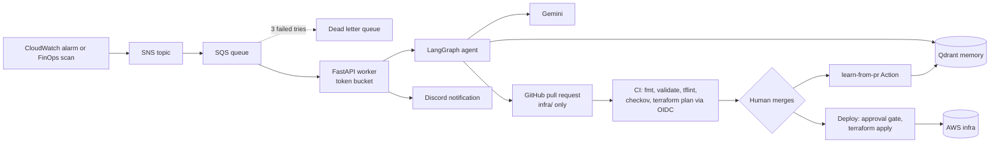
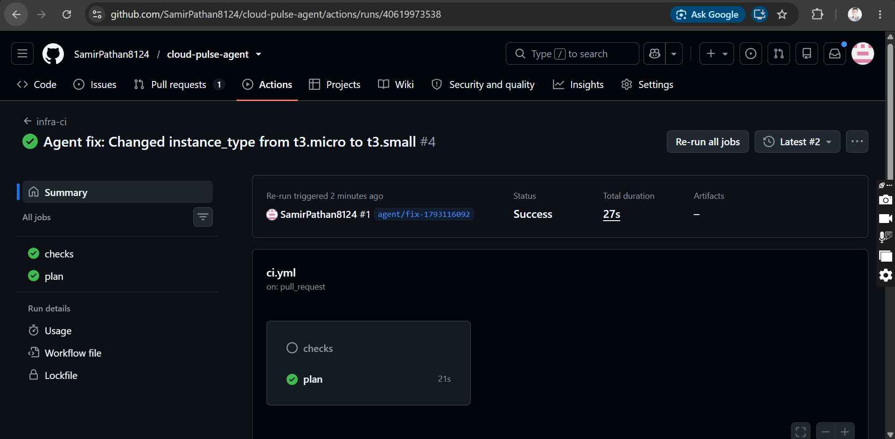
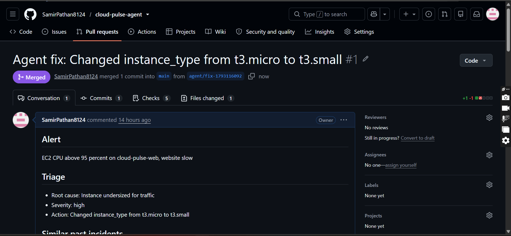
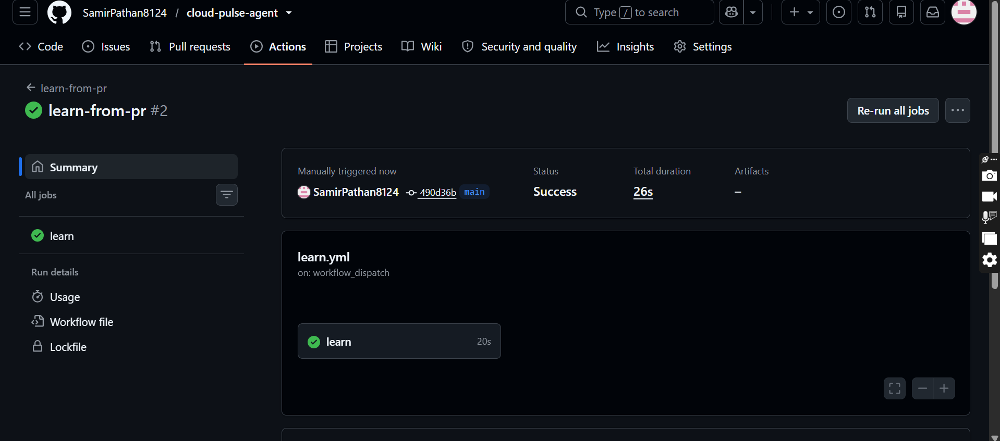
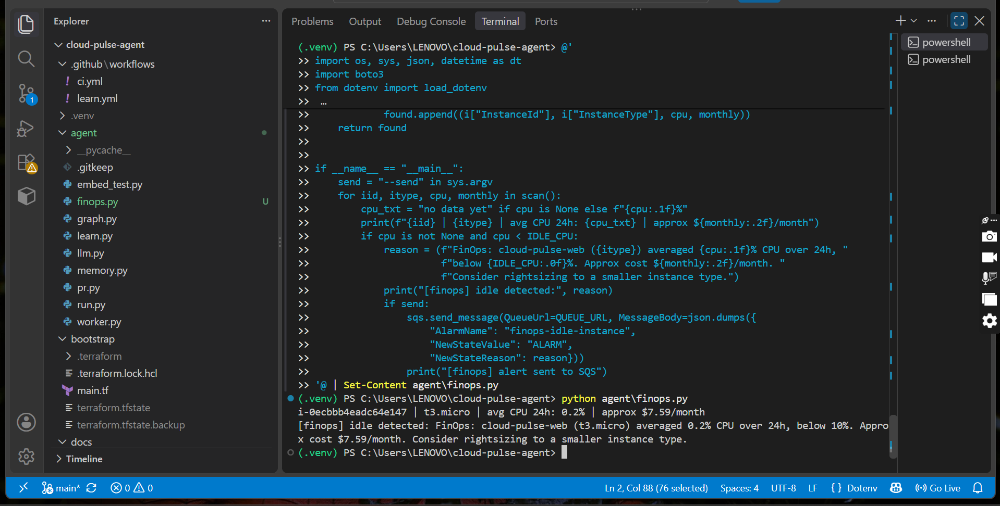
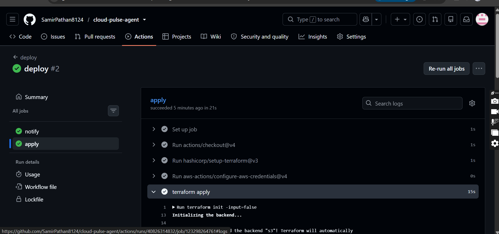

# Cloud-Pulse

**A GitOps-safe AI agent that turns cloud alerts into reviewed, tested Terraform pull requests.**


Cloud-Pulse listens to CloudWatch alarms and cost signals, looks up similar past incidents in a vector memory, proposes a minimal Terraform fix and opens a pull request. The agent never holds AWS credentials. Policy checks, a Terraform plan and two human approvals stand between its output and production.

## Contents
- [Why this project](#why-this-project)
- [Features](#features)
- [Architecture](#architecture)
- [End-to-end flow](#end-to-end-flow)
- [Components](#components)
- [Agent design](#agent-design)
- [Self-learning loop](#self-learning-loop)
- [FinOps scan](#finops-scan)
- [Safety and security design](#safety-and-security-design)
- [CI/CD pipeline](#cicd-pipeline)
- [Tech stack](#tech-stack)
- [Repository layout](#repository-layout)
- [Getting started](#getting-started)
- [Evaluation](#evaluation)
- [Design decisions and trade-offs](#design-decisions-and-trade-offs)
- [Cost](#cost)
- [Lessons learned](#lessons-learned)
- [Known limitations](#known-limitations)
- [Screenshots](#screenshots)
- [Author](#author)

## Why this project
On-call engineers handle the same kinds of alerts again and again: a saturated instance, an oversized instance wasting money. An LLM can draft the fix, but giving a model direct cloud access is risky, because it can be wrong, manipulated through alert text, or simply overconfident.

Cloud-Pulse takes a different approach. The agent can only **propose** a change as a pull request. Everything that keeps production safe (policy checks, a plan, approvals, least-privilege roles) is enforced by the pipeline, not by trusting the model.

## Features
- **Event-driven ingestion:** CloudWatch alarm, SNS, SQS with a dead letter queue, and a worker that rate-limits itself with a token bucket.
- **Vector memory:** past incidents and their outcomes are stored in Qdrant and retrieved by similarity (Gemini embeddings).
- **Multi-step agent:** a LangGraph flow of retrieve, triage, coder and reviewer, with a retry that carries reviewer feedback back to the coder.
- **Guardrails before any PR:** path allowlist, change-size limit, forbidden patterns, resource-count check and an AI reviewer.
- **Self-learning:** when a PR is merged or closed, the outcome is written back to memory.
- **FinOps scan:** detects idle instances from CloudWatch metrics and feeds the same pipeline.
- **No static AWS keys:** CI uses GitHub OIDC with separate roles for plan (read-only) and apply (only the `production` environment).
- **Approval-gated deploy:** a Discord message announces the pending apply; a human approves it in GitHub.
- **Observability:** a CloudWatch dashboard for CPU, alarm state and queue depth.

## Architecture




## End-to-end flow
1. A CloudWatch alarm (or the FinOps scan) publishes an alert to SNS, which delivers it to the SQS queue.
2. The FastAPI worker long-polls the queue. Only alerts in the `ALARM` state are processed, and a token bucket limits how fast the agent runs.
3. The agent retrieves similar past incidents from Qdrant, triages the alert and writes a minimal Terraform change.
4. Rule checks and an AI reviewer validate the change. If it is rejected, the coder retries once with the reviewer's feedback.
5. The PR module opens a pull request, restricted to files under `infra/`, and posts to Discord.
6. CI runs fmt, validate, tflint, Checkov and a `terraform plan`, posted as a PR comment.
7. A human reviews and merges (or closes) the PR.
8. On merge, the deploy workflow waits in the `production` environment. A human approves it, then `terraform apply` runs.
9. When the PR is closed, the learn workflow stores the outcome (`success` or `rejected`) in Qdrant for future alerts.

## Components
| Component | What it does |
|---|---|
| `agent/worker.py` | FastAPI service with an SQS long-polling loop, token bucket and a `/health` endpoint. Messages are deleted only after successful handling, so failures retry and then land in the DLQ. |
| `agent/graph.py` | LangGraph agent: retrieve, triage, coder, reviewer. |
| `agent/llm.py` | Gemini wrapper: JSON-only output, request timeout, retries and a model fallback list when one model is out of quota. |
| `agent/memory.py` | Qdrant collection and Gemini embeddings (768 dimensions, cosine). |
| `agent/pr.py` | Creates the branch, commits and opens the PR. Refuses any path outside `infra/`. |
| `agent/learn.py` | Reads closed agent PRs and stores their outcomes as lessons. |
| `agent/finops.py` | Reads average CPU from CloudWatch and sends an idle-instance alert to the queue. |
| `agent/notify.py` | Discord webhook helper. |
| `bootstrap/` | Terraform for the GitHub OIDC provider, plan role, apply role and the dashboard. |
| `eval/` | Evaluation of the agent with and without memory. |

## Agent design
**Graph.** `retrieve` (memory search and file read), then `triage` (root cause, severity, action), then `coder` (minimal change), then `reviewer`. If the reviewer rejects, the flow returns to `coder` once with the reviewer's reason.

**Memory.** Each incident stores the alert, root cause, resolution and outcome (`success`, `partial`, `failed` or `rejected`). The prompts tell the model that failed or rejected fixes did not work, so it avoids repeating them.

**Guardrails.** A change is rejected when any of these is true:
- the number of Terraform resources changes
- more than 6 lines are changed
- it adds forbidden content (`provisioner`, `local-exec`, `0.0.0.0/0`, `destroy`)
- the AI reviewer does not approve it

Alert text is treated as untrusted input, and model output must be valid JSON before it is used.

**Model handling.** The wrapper tries a list of Gemini models in order and moves to the next one on quota or availability errors. The list can be overridden with `GEMINI_MODELS`.

## Self-learning loop
Memory is not only seeded. After a human decides on an agent PR, the `learn-from-pr` workflow runs `agent/learn.py`. A merged PR becomes a `success` lesson, a closed PR becomes `rejected`. The next similar alert retrieves these lessons, so a fix a human rejected is shown to the model as something that did not work. Writes are keyed by PR number, so rerunning the script is safe.

## FinOps scan
`agent/finops.py` reads the 24-hour average CPU of the target instance from CloudWatch (cheap, unlike Cost Explorer API calls). If it is below `IDLE_CPU` (default 10 percent), it builds an alert with an approximate monthly cost and, with `--send`, puts it on the same SQS queue. The existing worker, memory, agent, PR and CI pipeline then handle it like any other alert.

## Safety and security design
| Risk | Control |
|---|---|
| Model changes things it should not | The agent has no AWS credentials. It can only open PRs; the PR module allows paths under `infra/` only. |
| Overreaching or malformed change | Change-size limit, forbidden patterns, resource-count check, AI reviewer. |
| Prompt injection through alert text | Alert text is untrusted, output must be valid JSON, and every change passes rule checks and CI. |
| Unsafe infrastructure code | Checkov, tflint and `terraform validate` run on every PR. |
| Surprise changes | A `terraform plan` is posted on every PR, and merge needs passing checks. |
| Leaked cloud keys | No static AWS keys. GitHub OIDC gives short-lived credentials. |
| Wrong repository or environment assumes a role | Trust policies are tied to this repository. The apply role can be assumed only from the `production` environment. |
| Over-broad CI permissions | Plan role is read-only. Apply role is limited to EC2, CloudWatch, SNS, SQS and the state bucket. |
| Unreviewed deploy | The deploy job waits for a human approval in a GitHub environment. |
| Alert floods | SQS buffering, a token bucket and a dead letter queue after 3 failed receives. |
| Secrets in git | `.env` is ignored, secrets live in GitHub Actions secrets, and the Docker image excludes `.env`. |

## CI/CD pipeline
| Workflow | Trigger | What it does |
|---|---|---|
| `ci.yml` (`infra-ci`) | Pull request touching `infra/` | `terraform fmt`, `validate`, `tflint`, Checkov, then a `terraform plan` through OIDC posted as a PR comment. |
| `deploy.yml` | Push to `main` touching `infra/`, or manual | Sends a Discord message, then waits for approval in the `production` environment before `terraform apply`. |
| `learn.yml` | Agent PR merged or closed | Stores the outcome in Qdrant. |
| `docker.yml` | Push to `main` | Builds the worker image and publishes it to GitHub Container Registry. |

## Tech stack
| Area | Tools |
|---|---|
| Cloud | AWS EC2, CloudWatch, SNS, SQS, IAM, S3 (Terraform state) |
| IaC and CI/CD | Terraform, GitHub Actions, GitHub OIDC, tflint, Checkov |
| AI | Gemini (generation and embeddings), LangGraph, Qdrant |
| Service | Python 3.12, FastAPI, boto3, PyGithub |
| Packaging and alerts | Docker, GHCR, Discord webhook |

## Repository layout
```text
cloud-pulse-agent/
├── agent/
│   ├── graph.py         LangGraph agent: retrieve, triage, coder, reviewer
│   ├── llm.py           Gemini wrapper: JSON output, timeout, model fallback
│   ├── memory.py        Qdrant memory and Gemini embeddings
│   ├── pr.py            Opens the PR (infra/ allowlist) and notifies Discord
│   ├── worker.py        FastAPI worker: SQS polling, token bucket, /health
│   ├── learn.py         Stores PR outcomes as lessons
│   ├── finops.py        Idle-instance scan that feeds the same queue
│   ├── notify.py        Discord webhook helper
│   └── run.py           One-shot CLI: run the agent and open a PR
├── infra/               Terraform the agent may edit (EC2, alarm, SNS, SQS, DLQ)
├── bootstrap/           OIDC provider, plan and apply roles, CloudWatch dashboard
├── eval/                Baseline file and evaluation script
├── docs/                Architecture, evaluation results, screenshots
├── .github/workflows/   ci.yml, deploy.yml, learn.yml, docker.yml
├── Dockerfile
└── requirements.txt
```

## Getting started
**Prerequisites:** Python 3.12, Terraform 1.10 or newer, AWS CLI configured with an admin user for the first setup, accounts for Qdrant Cloud, Google AI Studio and GitHub.

**Fork notes:** change the S3 backend bucket name in `infra/provider.tf`, and replace `SamirPathan8124/cloud-pulse-agent` in the trust policies in `bootstrap/main.tf` with your own repository.

**1. Install**
```powershell
python -m venv .venv
.venv\Scripts\Activate.ps1
pip install -r requirements.txt
```
On Linux or macOS, activate with `source .venv/bin/activate`.

**2. Configuration** (`.env`, never committed)
| Variable | Purpose |
|---|---|
| `GEMINI_API_KEY` | Gemini generation and embeddings |
| `GEMINI_MODELS` | Optional comma-separated fallback list |
| `QDRANT_URL`, `QDRANT_API_KEY` | Qdrant Cloud cluster |
| `GITHUB_TOKEN` | Fine-grained token for this repository only (Contents and Pull requests: read and write) |
| `GITHUB_REPO` | `owner/repo` |
| `QUEUE_URL` | SQS queue URL (Terraform output `queue_url`) |
| `DISCORD_WEBHOOK_URL` | Approval notifications |
| `DRY_RUN` | `1` prints what the agent would do, `0` opens real PRs |
| `IDLE_CPU` | FinOps threshold in percent (default 10) |

GitHub Actions needs the secrets `AWS_PLAN_ROLE_ARN`, `GEMINI_API_KEY`, `QDRANT_URL`, `QDRANT_API_KEY` and `DISCORD_WEBHOOK_URL`, plus `AWS_APPLY_ROLE_ARN` in the `production` environment.

**3. Deploy the foundations**
```powershell
cd bootstrap
terraform init
terraform apply
cd ../infra
terraform init
terraform apply
cd ..
```
`bootstrap` creates the OIDC provider, roles and dashboard. `infra` creates the instance, alarm, SNS topic, SQS queue and dead letter queue.

**4. Seed memory and run the worker**
```powershell
python agent/memory.py
uvicorn worker:app --app-dir agent --port 8000
```

**5. Trigger an alert** (from another terminal)
```powershell
aws cloudwatch set-alarm-state --region us-east-1 --alarm-name cloud-pulse-web-cpu-high --state-value ALARM --state-reason "Manual test: CPU above 95 percent"
```
With `DRY_RUN=1` the worker logs what the agent would do, and `http://localhost:8000/health` shows the counters. With `DRY_RUN=0` the agent opens a real pull request.

## Evaluation
The `eval/` folder compares the agent with and without memory on 8 fixed alerts against a fixed baseline `main.tf`. Scoring is rule-based: did the `instance_type` change in the expected direction (bigger, smaller or unchanged)? Run it with `python eval/eval.py --limit 4`; it resumes where it stopped, which helps with free-tier quotas.

The current results table is in [docs/eval-results.md](docs/eval-results.md). The memory holds a small seeded set plus real PR lessons, so this demonstrates the memory effect on a few cases. It is not a general benchmark.

## Design decisions and trade-offs
- **Pull requests instead of direct changes.** It is slower than auto-fixing, but every change is reviewable, testable and reversible, and it fits how teams already work.
- **SQS instead of Kafka.** The workload is small. SQS is managed, has dead letter queues built in and costs almost nothing.
- **OIDC with separate roles.** Plan is read-only and available to pull requests. Apply is possible only from the approval-gated environment.
- **Rule checks before an AI reviewer.** Deterministic checks catch most bad changes cheaply and predictably. The AI reviewer adds a second opinion.
- **CloudWatch metrics for FinOps.** Cost Explorer API calls are billed; CloudWatch reads are close to free.
- **Gemini free tier with a fallback list.** It keeps the project free to run, at the price of rate limits.
- **Discord for notification only.** Approvals stay in GitHub, where the audit trail and the branch protection already exist.

## Cost
Approximate figures for us-east-1, mostly pay-as-you-go:
- EC2: about 7.60 USD per month for `t3.micro`, about 15 USD for `t3.small` when left running.
- CloudWatch alarm, SNS and SQS: cents per month at this scale.
- Qdrant Cloud free tier, Gemini free tier, GitHub Actions and GHCR for a public repository: free.
- Cleanup: `terraform destroy` in `infra/` removes the instance, alarm and queues. The state bucket, OIDC roles and dashboard cost almost nothing.

## Lessons learned
- **GitHub's OIDC `sub` claim can include numeric IDs** (`repo:owner@id/name@id:pull_request`). A trust policy written for the plain format rejects the token with a generic error. Printing the token claims in CI made the fix obvious.
- **Secrets can carry a trailing newline.** One pasted URL broke the Qdrant client in CI. The code now strips whitespace and the secrets are copied programmatically.
- **Model availability changes.** Hard-coding one Gemini model failed twice (a model retired for new users and a daily quota). The fallback list and request timeouts fixed both.
- **Dry-run mode saves quota and mistakes.** Testing the queue and worker without calling the model or opening PRs made debugging much faster.
- **Re-running a workflow reuses the old workflow file.** To test a changed workflow, trigger a new event such as closing and reopening the PR.

## Known limitations
- One target (an EC2 instance) and one kind of fix (instance type).
- Memory is small and partly seeded, so evaluation results show a trend, not a benchmark.
- Alerts are not deduplicated, so a repeating alarm can create several PRs.
- Checkov runs in soft-fail mode, and the plan role uses AWS `ReadOnlyAccess`, which is broader than needed.
- The worker image is published to GHCR but is not hosted in the cloud; the worker runs locally.
- Discord is notification only; approvals happen in GitHub.
- Free-tier Gemini quotas limit how many runs are possible per day.

Possible next steps: alert deduplication, more resource types, a narrower plan role, hosting the worker on a managed container service and chat-based approvals through a bot.

## Screenshots

| Step | Screenshot |
|---|---|
| CI on every agent PR: fmt, validate, tflint, Checkov and a Terraform plan through OIDC | 



 |
| A human reviews and merges the agent's pull request | 



 |
| The PR outcome is written back to memory (self-learning) | 



 |
| FinOps scan finds an idle instance (0.2 percent CPU) | 



 |
| Approval-gated terraform apply | 



 |

## Author
**Samir Pathan** | [GitHub](https://github.com/SamirPathan8124) | [LinkedIn](https://www.linkedin.com/in/samir-pathan-218b84239)

