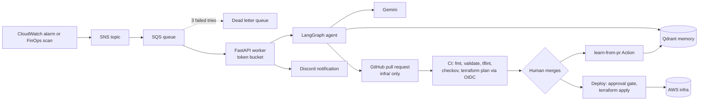

# Cloud-Pulse: GitOps-safe AI agent for AWS incident response and FinOps

An event-driven AI agent that reacts to CloudWatch alarms and cost signals, looks up similar past incidents in a vector memory, proposes a Terraform fix and opens a pull request. It never touches AWS directly: a human merges the PR and a human approves the deploy.

## Architecture

## How it works
1. A CloudWatch alarm or the FinOps scan sends an alert to SNS, then SQS (with a dead letter queue).
2. A FastAPI worker pulls alerts with a token-bucket rate limiter.
3. A LangGraph agent retrieves similar incidents from Qdrant, triages, writes a minimal fix and reviews it with rule checks plus an AI reviewer.
4. The agent opens a PR that can only change files under `infra/` and notifies Discord.
5. CI runs fmt, validate, tflint, Checkov and `terraform plan` using GitHub OIDC (no static AWS keys).
6. A human merges. The deploy job waits for approval in a GitHub environment, then runs `terraform apply`.
7. When the PR is merged or closed, a GitHub Action stores the outcome in memory, so the agent learns what worked and what was rejected.

## Safety design
- The agent has no AWS credentials. It can only open pull requests.
- File allowlist (`infra/` only), change-size limit, forbidden patterns, resource-count check.
- Plan role is read-only and bound to this repository through OIDC. The apply role exists only for the `production` environment.
- Branch ruleset on `main`: PR and passing checks required.
- Alert text is treated as untrusted input; model output is validated before any PR is created.

## Results
Memory vs no memory on 8 fixed alerts: see [docs/eval-results.md](docs/eval-results.md).

## Screenshots
| Step | Screenshot |
|---|---|
| Agent opens a PR | 

 |
| One-line diff | 

 |
| CI checks | 

 |
| Terraform plan comment | 

 |
| Worker handles an alert | 

 |
| Learns from PR outcome | 

 |
| FinOps scan | 

 |
| Discord notification | 

 |
| Deploy waits for approval | 

 |
| Dashboard | 

 |

## Known limitations
- Memory is a small seeded set of 8 incidents plus lessons from real PRs. The eval shows the memory effect, it is not a general benchmark.
- One target (an EC2 instance) and one kind of fix (instance type).
- Checkov runs in soft-fail mode and the plan role uses AWS ReadOnlyAccess, which is broader than needed.
- The worker image is built and published to GHCR but not hosted in the cloud; it runs locally, in dry-run mode by default.
- Built on the Gemini free tier, so runs are rate limited.
- Discord is notification only. Approvals happen on GitHub.

## Stack
AWS (EC2, CloudWatch, SNS, SQS), Terraform, GitHub Actions with OIDC, LangGraph, Gemini, Qdrant, FastAPI, Docker (GHCR), Discord webhook.

## Repo layout
`agent/` worker, agent graph, PR, learn and FinOps modules. `infra/` Terraform the agent may edit. `bootstrap/` OIDC roles and dashboard. `eval/` memory vs no-memory evaluation. `.github/workflows/` CI, deploy, learn and image build.

## Run locally
Python 3.12. Create `.env` with `GEMINI_API_KEY`, `QDRANT_URL`, `QDRANT_API_KEY`, `GITHUB_TOKEN`, `GITHUB_REPO`, `QUEUE_URL`, `DISCORD_WEBHOOK_URL`, `DRY_RUN`. Then run `uvicorn worker:app --app-dir agent --port 8000`.

## Author
Samir Pathan: [GitHub](https://github.com/SamirPathan8124) | [LinkedIn](https://www.linkedin.com/in/samir-pathan-218b84239)

